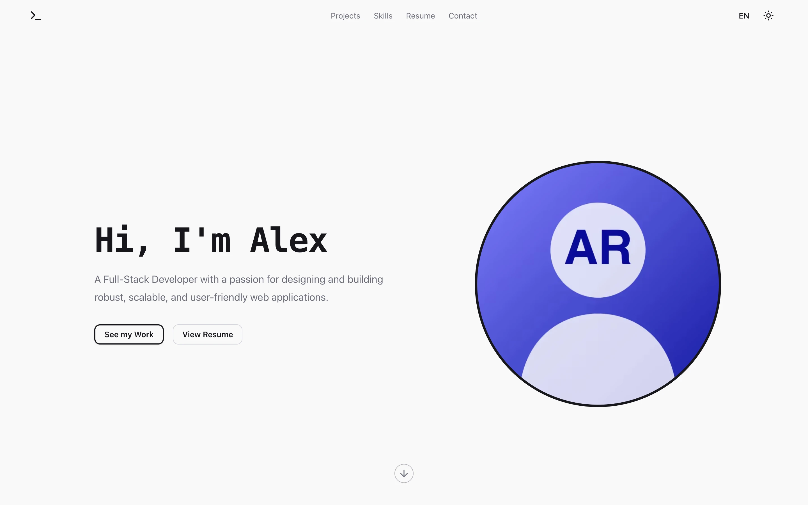
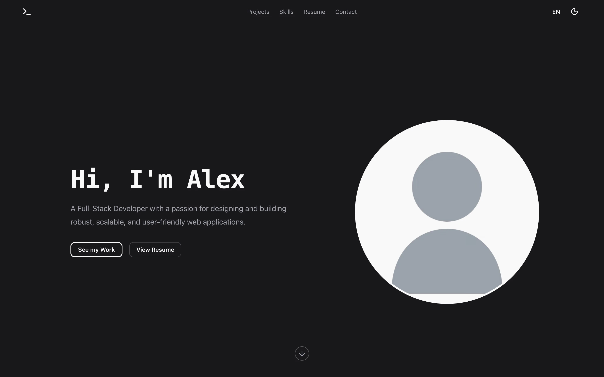
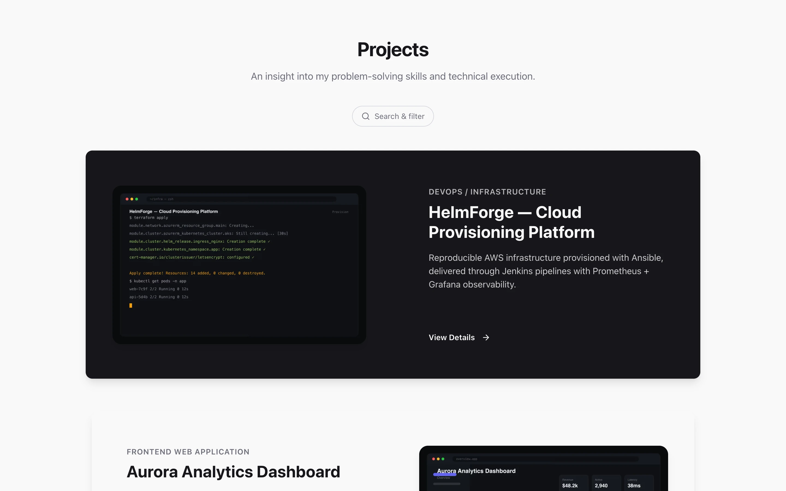
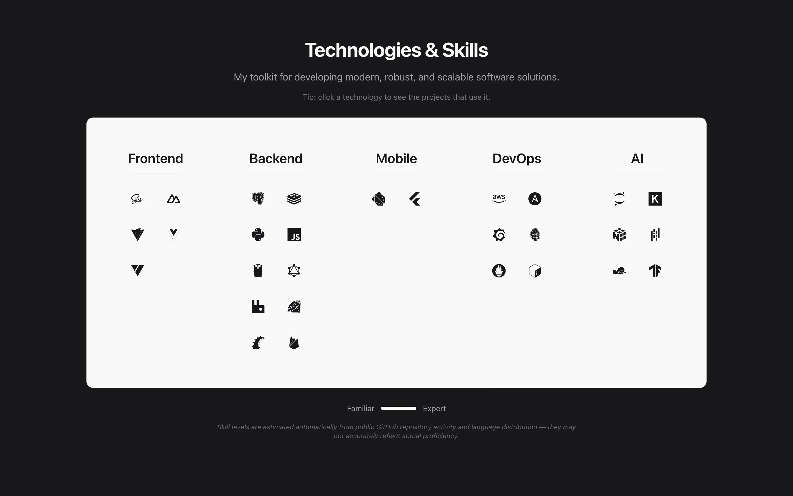
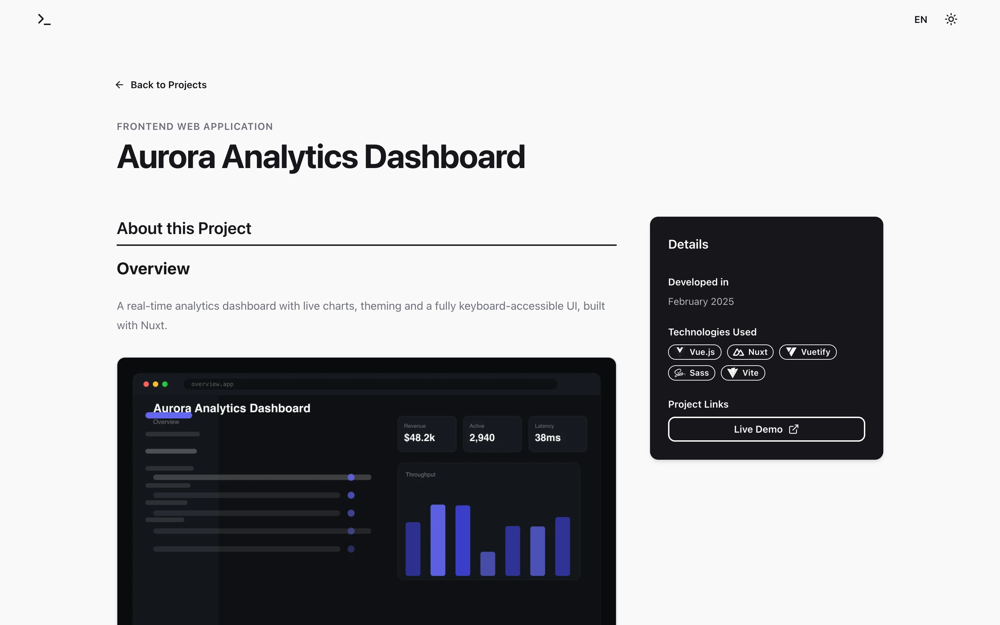
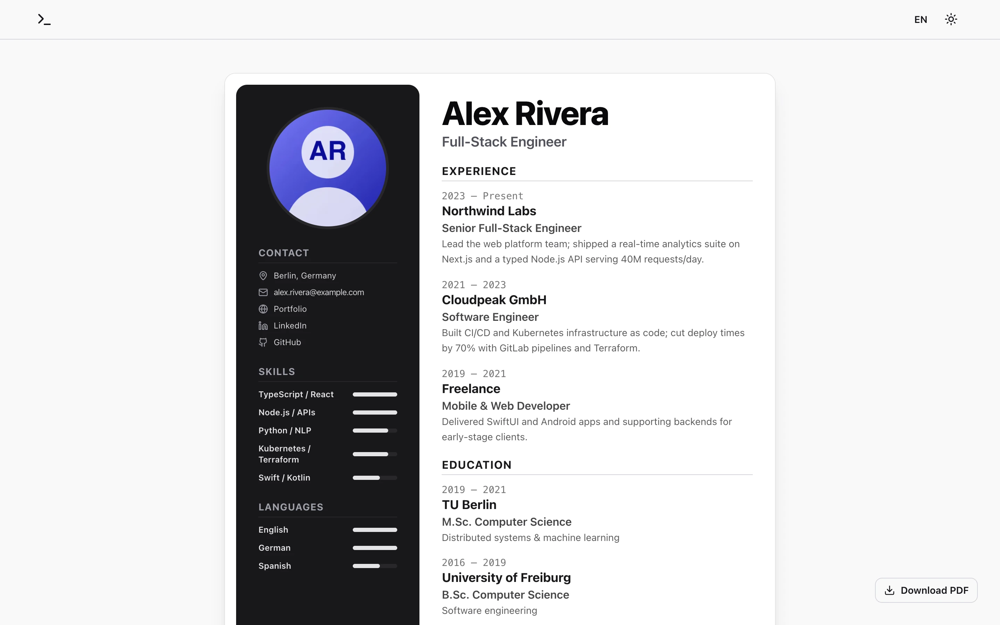

<!-- portfolio:date=2025-06-01 -->
# Codebase — Konfigurationsgesteuertes GitHub-Portfolio

**[English](README.md) · [Deutsch](README.de.md)**

<p align="center"></p>

Ein zweisprachiges (EN/DE) Next.js-Portfolio-Template ohne persönliche Daten im Repo — Projekte, Skills und Lebenslauf werden zur Build-Zeit aus GitHub geladen und über einen integrierten MCP-Career-Hub bereitgestellt.

## Highlights

- **GitHub-native zweisprachige Projektpipeline** — `scripts/fetch-portfolio.ts` lädt zur Build-Zeit alle `portfolio`- und `portfolio-private`-Repos, verarbeitet lokalisierte READMEs, optimiert Bilder mit sharp zu WebP und berechnet Full-Stack-Seiten samt Skill-Relevanz.
- **Integrierter MCP-Career-Hub (`/api/mcp`)** — stellt 25 Tools und 4 geführte Prompts über Streamable HTTP/SSE bereit, damit KI-Assistenten Repos prüfen, Rollenprofile abfragen, einseitige A4-Budgets validieren und PDFs per Puppeteer rendern können.
- **Getrennte Konfigurations-Architektur** — Identität, CV-JSON, Rechtstexte und Rollenprofile liegen ausschließlich in einem privaten `portfolio-config`-Repo, während ein mitgelieferter Demo-Datensatz Builds komplett ohne Secrets ermöglicht.
- **Terminal- & `curl`-Portfolio-Schnittstelle** — Next.js-Middleware erkennt CLI-Clients anhand des `User-Agent` und liefert eine ANSI-farbige Terminal-Ansicht (`/projects`, `/skills`, `/resume`, `?json=1`, `?plain=1`) hinter einem 3-stufigen Rate-Limiting.
- **Ghostty-Terminal-Hero & Motion-UI** — JetBrains-Mono-Hero mit OS-/Geräteerkennung (`Last login:`), animierter Rollenrotation, shadcn/ui-Komponenten, Tailwind CSS, scrollgesteuerten Framer-Motion-Karten und kombinierter Token-/Freitextsuche.
- **LinkedIn-Banner-Studio & CLI-Generator** — privates Studio unter `/banner`, REST-API, MCP-Tool und `npm run banner`-CLI erzeugen kollisionsfreie 1584×396-PNG- und SVG-Banner inklusive Sicherheitszone für das LinkedIn-Profilbild.

## Screenshots

<p align="center">
  
  
</p>
<p align="center">
  
  
</p>
<p align="center">
  
</p>

> Gerendert aus dem mitgelieferten **Demo-Datensatz** (`PORTFOLIO_DEMO=1 npm run build`) ohne persönliche Daten.

## Architektur

```
portfolio-config (privat, Topic: "portfolio-config")      Projekt-Repos ("portfolio" / "portfolio-private")
  .portfolio/{site.config,resume,coursework,               README.md / README.de.md + docs/screenshots/
              role-profiles,extra-projects}.json           Topics (über devicon + tech-registry.json aufgelöst)
                        │                                                 │
                        └────────────────────┬────────────────────────────┘
                                             ▼
                               scripts/fetch-portfolio.ts
                     (WebP-Bildoptimierung · Skill-Scoring · Career-JSON)
                                             │
                                             ▼
                      Next.js 15 App Router (EN/DE über next-intl · shadcn/ui)
                       ├── Statische Portfolio-Seiten & curl-Middleware (/api/cli)
                       ├── MCP-Server (/api/mcp) & A4-PDF-Renderer (Puppeteer)
                       └── LinkedIn-Banner-Studio (/banner) & SMTP-Kontakt-API
```

**Berechnung von Skill-Level & Relevanz:**
- **Proficiency-Level (1–5):** Programmiersprachen tragen `(Byte-Anteil) × effectiveWeight` bei (ab `>= 5 %` Codeanteil); Framework- und Tool-Topics zählen mit dem vollen `effectiveWeight` (logarithmische Repo-Größe + 3-Jahres-Aktualität) und werden auf die Stufen `1..5` abgebildet.
- **Relevanz-Sortierung:** Pro Kategorie werden die Top 12 Skills nach `Tiefe + Breite × 1,5 + exp(−AlterInJahren / 2) × 2,0` sortiert.

## MCP-Career-Hub, Banner-Studio & CLI

### MCP-Tools & Prompts (`/api/mcp`)

| Tool / Prompt | Zweck |
|---|---|
| `get_official_resume` / `get_canonical_resume` / `get_master_resume` | Lädt das veröffentlichte Website-CV, die Basisversion oder den vollständigen Master-Pool aus GitHub. |
| `sync_github_projects` | Liest `portfolio`- / `portfolio-private`-Repos bei Bedarf live neu in den `/tmp`-Cache (1×/Min Rate-Limit). |
| `get_coursework` | Fragt Studienleistungen, Noten und Abschlussarbeiten gefiltert nach Karriere-Track oder Mindestnote ab. |
| `list_role_profiles` / `get_role_profile` | Liefert vorbewertete, einseitige Lebenslauf-Daten, Kurse und passende Projekte pro Zielrolle. |
| `get_portfolio_repo_guidelines` / `audit_portfolio_repo` | Gibt die Portfolio-Regeln zurück und prüft ein Repo live inkl. konkreter `gh repo edit`-Vorschläge. |
| `get_layout_guidelines` / `validate_resume_layout` / `generate_tailored_resume` | Prüft A4-Höhenbudgets und rendert maßgeschneiderte CV-PDFs (60 Tage Aufbewahrung). |
| `get_cover_letter_template` / `validate_cover_letter_layout` / `generate_tailored_cover_letter` | Validiert Absatz- und Gesamtbudgets und erzeugt passende einseitige A4-Anschreiben. |
| `list_saved_variants` / `get_variant` / `list_saved_cover_letters` / `get_saved_cover_letter` | Durchsucht zuvor erstellte Lebenslauf- und Anschreiben-Varianten samt Download-Links. |
| `get_download_link` / `list_all_applications` / `recall_application_materials` / `prune_expired_materials` | Löst Download-URLs auf, ruft Bewerbungsstände zur Interview-Vorbereitung ab und bereinigt >60 Tage alte PDFs. |
| `get_linkedin_banner_guidelines` / `generate_linkedin_banner` | Liefert die Sicherheitszonen-Geometrie und rendert 1584×396-PNG/SVG-Banner. |
| Prompts: `tailor_cv_for_job`, `write_cover_letter_for_job`, `prep_for_interview`, `prepare_repo_for_portfolio` | Geführte Workflows für Lebenslauf-Tailoring, Anschreiben, Interview-Vorbereitung und Repo-Audits. |

### Terminal-Schnittstelle (`curl`) & Banner-CLI

- **Terminal-Ansicht:** `curl https://deine-domain.de`, `/projects`, `/skills`, `/resume`, `/contact`, `/<slug>` sowie `?plain=1`, `?json=1`, `?lang=de` und `?cli=1`, geschützt durch Edge-, Traefik- und In-App-Rate-Limiting.
- **Banner-CLI:** `npm run banner -- --title "AI Engineer" --name "Alex Rivera" --link "alexrivera.dev" --theme dark --out banners` exportiert 1584×396 PNG + SVG mit Profilbild-Abstand ab `x = 380px`.

## Tech-Stack

Full-Stack TypeScript · Next.js 15 (App Router) · React 19 · Tailwind CSS · shadcn/ui · Framer Motion · next-intl · Model Context Protocol (`@modelcontextprotocol/sdk`) · Puppeteer · sharp · nodemailer · Docker · GitHub Actions

## Einrichtung

```bash
cp .env.example .env.local        # GITHUB_TOKEN (+ optional SMTP / Umami / RESUME_MCP_API_KEY)
npm install
npm run build                     # Führt fetch-portfolio.ts und next build aus
PORTFOLIO_DEMO=1 npm run build    # Offline-Demo-Build mit mitgeliefertem demo/-Datensatz
npm run typecheck && npm run lint
```

Ein Push auf `main` baut über GitHub Actions das Docker-Image (`GITHUB_TOKEN` nur als BuildKit-Secret), pusht es zu GHCR und triggert ein signiertes Redeploy. Lizenziert unter **CC BY-NC 4.0** (siehe [`LICENSE`](LICENSE)).
