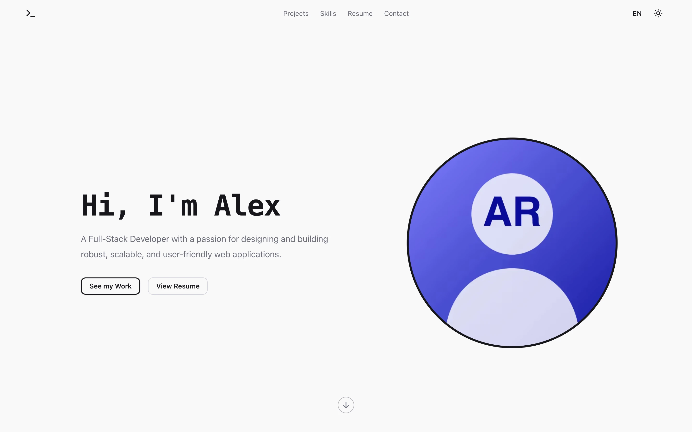
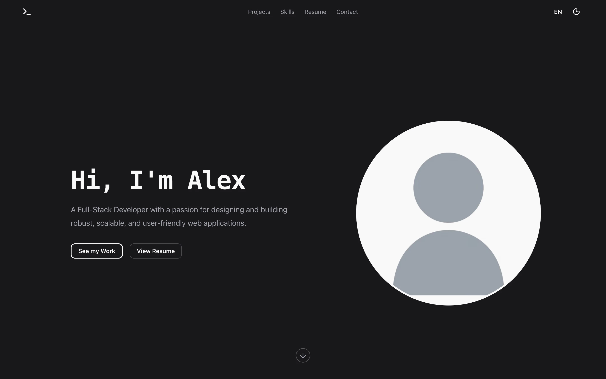
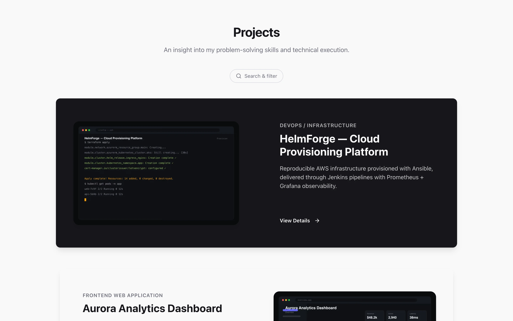
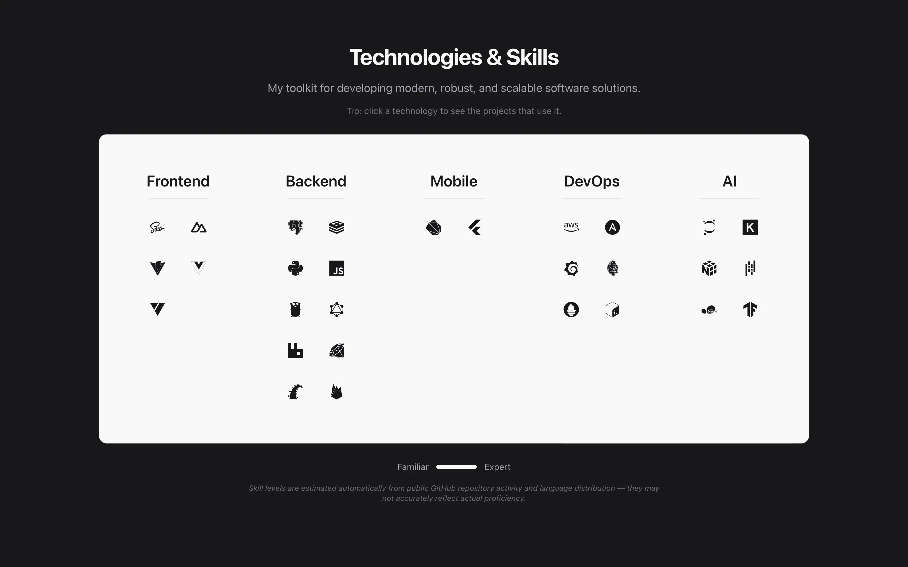
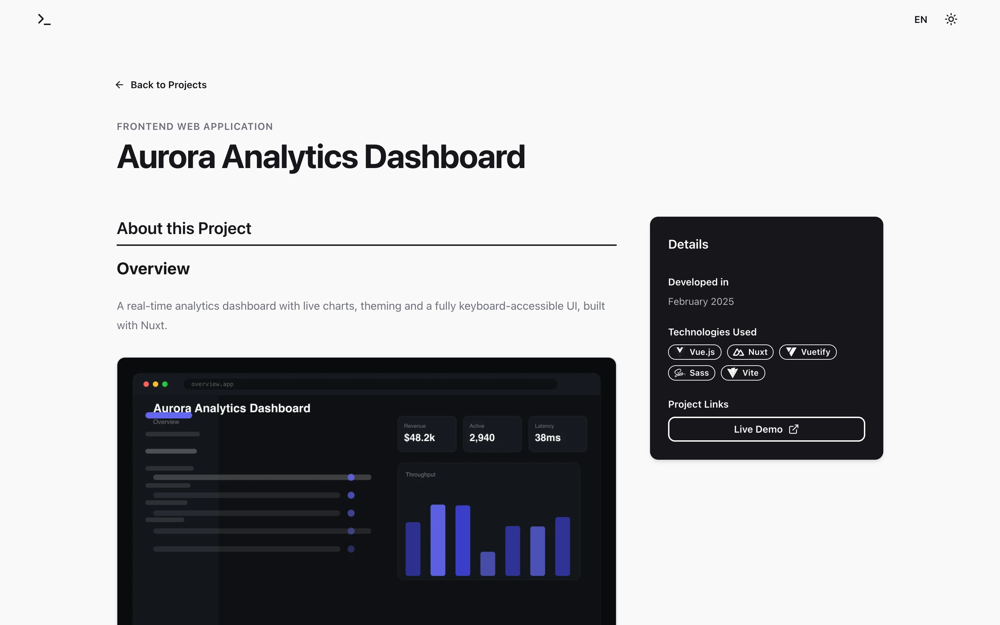
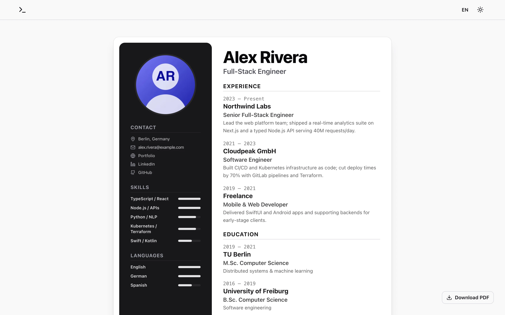

<!-- portfolio:date=2025-06-01 -->
# Codebase — Config-Driven GitHub Portfolio

**[English](README.md) · [Deutsch](README.de.md)**

<p align="center"></p>

A bilingual (EN/DE) Next.js developer portfolio template with zero personal data in the repo — projects, skills, and résumés are synced from GitHub at build time and served via an integrated MCP career hub.

## Highlights

- **GitHub-native bilingual project pipeline** — `scripts/fetch-portfolio.ts` pulls `portfolio` and `portfolio-private` repos at build time, parses localized READMEs, converts images to WebP via sharp, and builds full-stack static pages plus skill proficiency rankings.
- **Integrated MCP career hub (`/api/mcp`)** — exposes 25 tools and 4 guided prompts over Streamable HTTP/SSE so AI assistants can audit repos, query role profiles, validate A4 height budgets, and render tailored PDF résumés and cover letters via Puppeteer.
- **Privacy-separated config architecture** — identity, CV JSON, legal pages, and role overrides live in a single private `portfolio-config` repo injected at build time, while a bundled demo dataset lets clean clones build with zero secrets.
- **Terminal & `curl` portfolio interface** — middleware inspects `User-Agent` headers and routes shell requests to an ANSI-colored CLI view (`/projects`, `/skills`, `/resume`, `?json=1`, `?plain=1`) guarded by 3-tier rate limiting.
- **Ghostty terminal hero & motion UI** — JetBrains Mono hero with OS/device detection (`Last login:`), typed role rotations, shadcn/ui components, Tailwind CSS, Framer Motion scroll-driven cards, and instant token/text project filtering.
- **Visual LinkedIn Banner Studio & CLI** — private `/banner` artboard, REST endpoint, MCP tool, and `npm run banner` CLI exporting collision-safe 1584×396 PNG and vector SVG banners tuned for LinkedIn's avatar crop zone.

## Screenshots

<p align="center">
  
  
</p>
<p align="center">
  
  
</p>
<p align="center">
  
</p>

> Rendered from the bundled **demo dataset** (`PORTFOLIO_DEMO=1 npm run build`) with no personal data.

## Architecture

```
portfolio-config (private, topic: "portfolio-config")     project repos ("portfolio" / "portfolio-private")
  .portfolio/{site.config,resume,coursework,               README.md / README.de.md + docs/screenshots/
              role-profiles,extra-projects}.json           topics (mapped via devicon + tech-registry.json)
                        │                                                 │
                        └────────────────────┬────────────────────────────┘
                                             ▼
                               scripts/fetch-portfolio.ts
                     (WebP image optimization · skill scoring · career JSON)
                                             │
                                             ▼
                      Next.js 15 App Router (EN/DE via next-intl · shadcn/ui)
                       ├── Static portfolio pages & terminal curl middleware (/api/cli)
                       ├── MCP server (/api/mcp) & A4 PDF renderer (Puppeteer)
                       └── LinkedIn Banner Studio (/banner) & SMTP contact API
```

**Skill proficiency & relevance ranking:**
- **Proficiency level (1–5):** Languages contribute `(byte share) × effectiveWeight` (if `>= 5%` of codebase); framework/tool topics contribute full `effectiveWeight` (logarithmic repo size + 3-year recency factor). Thresholds map scores to levels `1..5`.
- **Category relevance ranking:** Keeps the top 12 skills per category ordered by `depth + breadth × 1.5 + exp(−ageYears / 2) × 2.0`.

## MCP Career Hub, Banner Studio & CLI

### MCP Tools & Prompts (`/api/mcp`)

| Tool / Prompt | Purpose |
|---|---|
| `get_official_resume` / `get_canonical_resume` / `get_master_resume` | Fetch the live published CV, canonical baseline, or full GitHub-enriched master pool. |
| `sync_github_projects` | Refresh GitHub `portfolio` / `portfolio-private` projects into runtime `/tmp` cache (rate-limited to 1/min). |
| `get_coursework` | Query university coursework, grades, and theses filtered by role track or minimum grade. |
| `list_role_profiles` / `get_role_profile` | Retrieve pre-ranked single-page-safe CVs, coursework, and projects per target track. |
| `get_portfolio_repo_guidelines` / `audit_portfolio_repo` | Read portfolio formatting rules and run a live read-only audit with `gh repo edit` fixes. |
| `get_layout_guidelines` / `validate_resume_layout` / `generate_tailored_resume` | Check single-page A4 height budgets and render tailored CV PDFs (60-day retention). |
| `get_cover_letter_template` / `validate_cover_letter_layout` / `generate_tailored_cover_letter` | Validate paragraph/total budgets and render matching single-page A4 cover letters. |
| `list_saved_variants` / `get_variant` / `list_saved_cover_letters` / `get_saved_cover_letter` | Inspect previously generated CV and cover-letter variants and download URLs. |
| `get_download_link` / `list_all_applications` / `recall_application_materials` / `prune_expired_materials` | Resolve download links, recall submitted materials for interviews, and prune >60-day artifacts. |
| `get_linkedin_banner_guidelines` / `generate_linkedin_banner` | Read safe-zone geometry and render 1584×396 PNG/SVG LinkedIn banners. |
| Prompts: `tailor_cv_for_job`, `write_cover_letter_for_job`, `prep_for_interview`, `prepare_repo_for_portfolio` | Guided workflows for tailoring applications, interview prep, and preparing project repos. |

### Terminal (`curl`) & Banner CLI

- **Terminal interface:** `curl https://your-domain.com`, `/projects`, `/skills`, `/resume`, `/contact`, `/<slug>`, plus `?plain=1`, `?json=1`, `?lang=de`, and `?cli=1` protected by edge, Traefik, and sliding-window rate limiters.
- **Banner CLI:** `npm run banner -- --title "AI Engineer" --name "Alex Rivera" --link "alexrivera.dev" --theme dark --out banners` exports 1584×396 PNG + SVG with avatar clearance at `x = 380px`.

## Tech Stack

Full-Stack TypeScript · Next.js 15 (App Router) · React 19 · Tailwind CSS · shadcn/ui · Framer Motion · next-intl · Model Context Protocol (`@modelcontextprotocol/sdk`) · Puppeteer · sharp · nodemailer · Docker · GitHub Actions

## Getting Started

```bash
cp .env.example .env.local        # Add GITHUB_TOKEN (+ optional SMTP / Umami / RESUME_MCP_API_KEY)
npm install
npm run build                     # Runs fetch-portfolio.ts, then next build
PORTFOLIO_DEMO=1 npm run build    # Offline demo build using bundled demo/ dataset
npm run typecheck && npm run lint
```

Push to `main` builds a Docker image (passing `GITHUB_TOKEN` as a BuildKit secret), pushes it to GHCR, and redeploys via a signed webhook. Licensed under **CC BY-NC 4.0** (see [`LICENSE`](LICENSE)).
